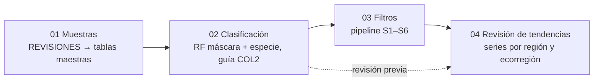

# MapBiomas Chile · Colección 3 · Silvicultura

Flujo completo de la clase transversal **silvicultura** (pino 79, eucalipto 80, cosechado 83) en Google Earth Engine (JavaScript): desde la toma de muestras hasta la revisión de tendencias.

Cada archivo `codigo_*.js` es un script que se **pega tal cual en el Code Editor de GEE** (no hay build). Los parámetros están al inicio de cada script, y la cabecera explica qué hace y qué assets lee o escribe.

## Flujo



| Etapa | Carpeta | Entrada | Salida |
| --- | --- | --- | --- |
| 1. Muestras | [`01_muestras`](01_muestras/) | polígonos revisados (`REVISIONES`) y tablas `SAMPLES_TRIMESTRAL` | `MODEL_SAMPLES/train_master_e{eco}_{ver}` y `train_cosecha_e{eco}_{ver}` |
| 2. Clasificación | [`02_clasificacion`](02_clasificacion/) | tablas maestras, mosaicos trimestrales, COL2 (plantación = 9) | `CLASSIFICATIONS/PRELIMINAR/SILVICULTURA/silvo_e{eco}_{año}_{ver}` (clase + probabilidades) |
| 3. Filtros | [`03_filtros`](03_filtros/) | `silvo_e{eco}_{año}_{ver}`, MapBiomas Fuego | `silvo_filtrado_e{eco}_{ver}` (bandas `silvicultura_`, `final_`, `paso_`) |
| 4. Revisión | [`04_revision_tendencias`](04_revision_tendencias/) | clasificaciones exportadas e integración V1 (reglas / HMM) | gráficos y CSV de hectáreas por año y región |

Clases de la clasificación preliminar: 1 pino · 2 eucalipto · 3 otras · 4 cosechado. Códigos finales (paso S6): 79 · 80 · 83.

## Estructura

```
01_muestras/                 extracción y exportación de muestras, control de calidad
  analisis/                  separabilidad pino/eucalipto y diagnóstico de ciclos
02_clasificacion/            clasificador (visor con interfaz), piloto, verificación, limpieza de versiones
03_filtros/                  pipeline de filtros S1–S6 y relleno de huecos
04_revision_tendencias/      visores de revisión (por ecorregión y por región político-administrativa)
docs/                        documentos del pipeline (md, docx, pdf), decisiones y prompts de apoyo
tests/                       pruebas con simulaciones de Earth Engine y de la interfaz
scripts/                     revisión de sintaxis y ejecución de tests
archivo/                     versiones anteriores de scripts, solo referencia
```

## Decisiones vigentes del equipo

- Código de cosechado final: **83**.
- Filtro de incendios: **2013–2025** con MapBiomas Fuego Col 1 (`FIRE/COLLECTION1/CLASSIFICATION/burned_area_chile_year_11`). Extender a 1996–2012 con GABAM queda por discutir.
- Área mínima S3: **11 px (≈ 1 ha)**, como el filtro general. Consistencia espacial de especie S5: **22 px (≈ 2 ha)**, a calibrar.
- En el retorno de uso, 79, 80 y 83 cuentan como un solo uso (silvicultura). Ver [`docs/decisiones`](docs/decisiones/).

## Comprobaciones

```bash
node scripts/check_syntax.js   # sintaxis de todos los .js
node scripts/run_tests.js      # 10 tests con simulaciones
```

Los tests usan **simulaciones** de la API de Earth Engine y de los widgets: comprueban la lógica de los scripts, pero no sus resultados sobre los assets reales. Ningún script de este repo se ha validado automáticamente contra GEE; la prueba real es correrlo en el Code Editor.

## Pendientes conocidos

- **Buffer de 5 km:** el clasificador (y la región de trabajo de los filtros) incluye una franja alrededor de cada ecorregión. Las ecorregiones vecinas se solapan en esa franja. Al contar áreas o integrar hay que recortar cada una a su propia ecorregión (`ECO_RASTER.eq(eco)`); `revisar_silvicultura_regiones` ya lo hace. Aún no se ha probado con GEE real, y el cálculo del buffer puede ser más pesado en ecorregiones grandes.
- Los visores de la etapa 4 leen `silvo_e{eco}_{año}_{ver}` (y la integración V1); todavía **no leen** el formato `silvo_filtrado_e{eco}_{ver}` que exporta el pipeline de la etapa 3.
- Documento `docs/filtros/pipeline_filtros_silvicultura.docx`: falta incorporar las decisiones de arriba (11 px, 22 px, 2013–2025, código 83).
- S4 no rellena años aislados de "otras" entre años de silvicultura sin cosecha; podría explicar parte de la caída de pino 2007–2011.
- Integración `hmm`: faltan por cargar algunas ecorregiones (E3 y E8 al momento de escribir esto).
- La exportación con botón (Export desde un callback de la interfaz) puede no crear tareas según la versión del Code Editor; si pasa, usar el modo por script de cada etapa.
- Las tablas `sample_silvo_*` y `sample_base_*` de `SAMPLES_TRIMESTRAL` son la entrada de las tablas maestras, pero el script que las genera no está en este repo.
